<p align="center">
  
</p>

<p align="center">
  
  
  
</p>

## Building beyond the tutorial

I'm a Dev & AI student interested in systems that do more than generate an answer: they coordinate tools, work with real data and help people make better decisions.

I like projects where product, engineering and business meet — from the first messy need to a working prototype that can be tested by real users.

```text
current_direction/
├── agentic systems and multi-agent orchestration
├── local-first AI and private workflows
├── data products with measurable outcomes
└── ambitious prototypes built around real constraints
```

## Current builds

| Project | What it explores | Status |
|---|---|---|
| **AGREEN DEFI SAED** | Turning fragmented agricultural knowledge into an AI-assisted experience | Starting |
| **Irigo Digital Twin** | Real-time transit feeds, normalization and operational visualization | Building |
| **Football Probability Engine** | Honest probabilistic modelling and historical replay | Building |
| **Absolute Cinema** | A collectible-card web product built around a movie dataset | Building |

## Toolkit

<p>
  
</p>

## What I want to learn next

- Designing reliable multi-agent systems instead of isolated prompts
- Running useful AI workflows locally when privacy or latency matters
- Building observable systems with evaluations, traces and clear failure modes
- Connecting technical systems to an actual business or operational outcome

<p align="center">
  <sub>Build something useful. Measure what works. Keep the system honest.</sub>
</p>
