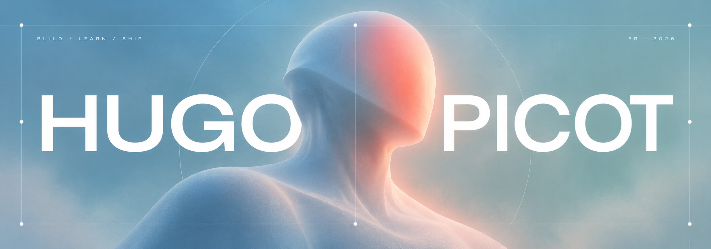

<p align="center">
  
</p>

### 01 / ABOUT

I’m a developer and AI student in France. I like the moment when a vague problem stops being a slide deck and becomes something people can actually test.

Right now, I’m learning through real constraints: live transport data, probabilistic models, fragmented agricultural knowledge and a web product built with a team.

---

### 02 / IN PROGRESS

| | Project | The real problem |
|---:|---|---|
| `01` | **AGREEN DEFI — SAED** | Turn scattered agricultural resources into a useful, testable experience. |
| `02` | **[Irigo Digital Twin](https://github.com/hugopicot/Jumeau-Numerique-Irigo)** | Make live public-transport data understandable and operational. |
| `03` | **[Football Probability Engine](https://github.com/hugopicot/fotchebal-so-ney-do-brazzzzil)** | Model uncertainty honestly instead of pretending to predict the future. |
| `04` | **[Absolute Cinema](https://github.com/Sidraxx/projet-fil-rouge/tree/develop)** | Build a collectible movie-card product from database to interface. |

---

### 03 / HOW I WORK

```text
understand the constraint → build the smallest honest version → test it → iterate
```

I care about the whole path: framing the problem, handling the data, building the product and seeing what survives contact with reality.

`Python` · `TypeScript` · `JavaScript` · `PHP` · `Java` · `SQL` · `Next.js` · `Git`

---

<p align="center">
  <sub>Currently looking for harder problems, sharper feedback and work worth showing.</sub>
</p>
